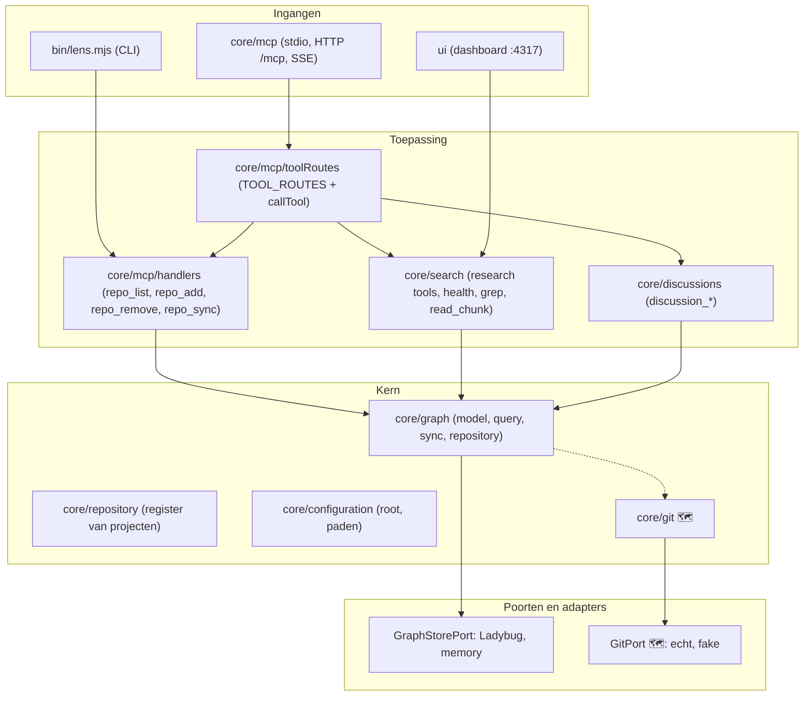

# lady-lens: architectuur

**Status**: ontwerp en stand van zaken, 2026-11-02. ✅ = aanwezig, 🗺️ = gepland (zie `backlog/`).
**Doel**: een kennislaag over code (graaf, zoeken, discussies) die vanuit CLI, MCP en dashboard dezelfde antwoorden geeft, voor meerdere projecten en branches tegelijk, en die je zonder trage processen of echte databases kunt testen.

---

## 1. Kernvisie

lady-lens indexeert een repository in een graaf (bestanden, functies, imports, aanroepen, tests, documenten, discussies) en beantwoordt vragen daarover. Vier regels sturen het ontwerp:

1. **Poorten en adapters.** Alles wat I/O doet (graafopslag, git, bestandssysteem) zit achter een poort met een echte adapter en een geheugen-adapter. De logica kent alleen de poort.
2. **Functies, geen classes.** Fabrieken (`createGraphSync`, `createMemoryRepositoryStore`, straks `createGit`) leveren functies terug; afhankelijkheden komen als parameter binnen. ESLint verbiedt `class` (✅).
3. **Eén handler per bewerking, meerdere ingangen.** CLI, MCP (stdio, HTTP, SSE) en dashboard roepen dezelfde handlers aan; geen eigen kopie van de logica per ingang (✅ voor `repo_*`, zie 4).
4. **Klein en vlak.** Elk bestand maximaal 200 regels, elke functie maximaal complexiteit 5 (🗺️), vertakken met opzoektabellen en routers en niet met `if`-ketens.

---

## 2. Lagen



Imports tussen modules lopen uitsluitend via `index.js` (✅ `test/moduleApi.test.js`).

---

## 3. Poorten

| Poort | Contract | Adapters | Stand |
| :--- | :--- | :--- | :--- |
| `GraphStorePort` (`core/graph/ports`) | `projectFiles`, `applyProjectChanges`, `replaceScope`, `loadGraph`, `upsertNodes`, `relate`, `stats`, … | Ladybug (`.lbdb`), memory | ✅ |
| `GitPort` (`core/git`) | `currentBranch`, `headCommit`, `commitExists`, `mergeBase`, `diffNameStatus`, `statusPorcelain`, `logRange`, `logForPath`, `listTree`, `readBlob`, `mergeTree` | `createGit({ root, run })`, `createFakeGit(state)` | 🗺️ |

Elke poort heeft één contracttest die beide adapters door hetzelfde scenario haalt (✅ `test/ports/` voor de graaf, 🗺️ voor git). Alleen `run` in `core/git` mag `git` starten; daardoor draait bijna elke test zonder proces.

---

## 4. Ingangen delen handlers

Elke beheerbewerking is één bestand in `core/mcp/handlers/` dat gewone data teruggeeft:

- `repoList`, `repoAdd`, `repoRemove`, `repoSync` ✅
- MCP: `TOOL_ROUTES` is een lijst `{ name, handle }`; `callTool` zoekt de route op naam en verpakt het resultaat als MCP-tekst. Een onbekende naam gaat naar `RESEARCH_TOOLS`. ✅
- CLI: `lens add | remove | sync` roepen dezelfde handlers aan en printen het resultaat. ✅
- Een nieuwe bewerking toevoegen is één bestand plus één regel in de lijst.

**Draaiende daemon (✅):** `lens mcp -d` start MCP (:4318) en dashboard (:4317). `daemon.json` houdt alle gestarte PID's bij; `lens ps` toont ze, `lens stop [pid]` stopt alles of één proces.

---

## 5. Meerdere projecten en branches

- **Eén daemon, meerdere projecten (✅).** Een client kiest zijn project met `/mcp?repo=<map|id>` (of `X-Lens-Repo`); het dashboard met `/?repo=…`. Alleen geregistreerde repo's worden geaccepteerd (403 anders). Per toolaanroep kan `repo` dit overschrijven.
- **Actieve repo is procesbrede toestand.** `activateRepoContext` zet `REPO_ROOT` en `LENS_GRAPH_DB`. Daarom lopen alle toolaanroepen en dashboardverzoeken via één vergrendeling (`withRepoLock`, `runInRepo`). Dat voorkomt vermenging maar maakt aanroepen voor verschillende projecten sequentieel; een volgende stap is de repo-context per verzoek in plaats van in `process.env` (🗺️).
- **Branches (🗺️, `backlog/branch-bewuste-graaf.md`).**
  - Eén database, een scope per branch (`branch:<naam>`); de projectscope blijft de uitgecheckte werkkopie.
  - `Commit`- en `Branch`-knooppunten (`Branch -HEAD_AT-> Commit`) in de graaf; de laatst gesyncte commit staat dus bij de inhoud.
  - Sync via `git diff <bewaard>..HEAD` plus `git status`; terugval op de volledige scan als de commit ontbreekt of onbereikbaar is.
  - Een branch indexeren zonder uitchecken (`ls-tree`, `cat-file --batch`).
  - `branch_diff` en `branch_impact`: een bugfix op `release` toont welke aanroepers en overlappende wijzigingen in een feature geraakt worden.
- **Discussies (🗺️).** Een discussie staat in een eigen scope en blijft bestaan; na elke sync legt `relinkDiscussions` de relaties naar bronnen opnieuw (verwijderen van een bestand neemt nu zijn relaties mee). Nieuwe discussies krijgen `CREATED_AT` en `ON_BRANCH`.

---

## 6. Afdwingen: principe, mechanisme, stand

| Principe | Hoe | Stand |
| :--- | :--- | :--- |
| Klein bestand (max. 200 regels) | `test/codeStructure.test.js` (uitzonderingen mogen alleen krimpen) | ✅ |
| Geen classes | ESLint `no-restricted-syntax` | ✅ |
| Imports via `index.js` | `test/moduleApi.test.js` | ✅ |
| Poorten inwisselbaar (LSP) | contracttests in `test/ports/` | ✅ graaf, 🗺️ git |
| Geen directe `git`/`child_process` buiten de adapter | architectuurtest | 🗺️ |
| Complexiteit ≤ 5 per functie | ESLint `complexity` plus uitzonderingslijst die alleen krimpt | 🗺️ |
| Geen `else if`-ketens, geen diepe nesting | ESLint `no-restricted-syntax`, `max-depth`, `no-else-return` | 🗺️ |
| Ontwerpgeuren zichtbaar | `lens ask health` (zie 7) | 🗺️ |
| Prestaties bewaakt | `test/performance.test.js`, `runGraphEval`, `scripts/benchmark.mjs`, `scripts/lens-scale.mjs` | ✅, uit te breiden |

Meting 2026-11-02 met lens zelf: 156 van 686 functies (23%) boven complexiteit 5, waarvan 39 boven 15. Die vormen de beginlijst voor de uitzonderingen (`backlog/if-ketens-afdwingen.md`).

---

## 7. Ontwerpgeuren in `health` (🗺️)

`health` toont nu al per functie `cyclomaticComplexity`, `lines` en `params`. De complexiteitsdrempel wordt een query (`cyclomaticComplexity > drempel`) in plaats van een vlag die bij de sync is vastgelegd. Voor geuren die niet als getal in de graaf staan legt de sync de feiten eerst vast; daarna zijn het gewone queries met een vast advies:

| Issue | Advies (patroon) |
| :--- | :--- |
| `dispatch-chain` | opzoektabel of router (zoals `toolRoutes.js`) |
| `deep-nesting` | guard clauses, functie opsplitsen |
| `flag-parameter` | twee functies of een strategie meegeven |
| `repeated-literal` | constante of opsomming |
| `global-mutable-state` | fabriek met eigen toestand, afhankelijkheid meegeven |
| `direct-io` | poort, adapter en fake |
| `god-module` | splitsen langs verantwoordelijkheid |

---

## 8. Doelstructuur

```text
bin/lens.mjs                 # alleen argumenten lezen en handlers aanroepen
core/
  configuration/             # root, paden, instellingen
  repository/                # register van projecten (id, pad, database)
  graph/
    model/ query/ sync/      # puur: graafmodel, vragen, indexeren
    repository/              # scopes, validatie, DTO's
    ports/graphStorePort.js
    adapters/{ladybug,memory}/
  git/                       # 🗺️ index.js, createGit, createFakeGit
  search/                    # research tools, health, grep, read_chunk
  discussions/               # opslaan, koppelen, bevragen
  mcp/
    handlers/                # één bestand per bewerking
    toolRoutes.js            # lijst { name, handle } en callTool
    server.js httpServer.js streamableHttp.js daemon.js
  language/ eval/ observability/
ui/                          # dashboard, volgt ?repo=
test/
  ports/                     # contracttests per poort
  codeStructure.test.js moduleApi.test.js performance.test.js
backlog/                     # branch-bewuste-graaf.md, if-ketens-afdwingen.md
```

---

## 9. Volgorde van uitvoeren

1. `core/git` met fake en contracttest; bestaande git-aanroepen (`gitHistory.js`) overzetten.
2. Test die het verlies van discussiekoppelingen na een branch-wissel aantoont.
3. `Commit`/`Branch`-knooppunten, sync via git-diff, `relinkDiscussions`.
4. Branch-scopes, `branch_diff`, `branch_impact`.
5. Complexiteit 5 met uitzonderingslijst, ESLint-regels, `health`-geuren.
6. Repo-context per verzoek in plaats van `process.env` en een vergrendeling.

Elke stap is afzonderlijk commitbaar en laat `vitest` en `eslint` groen.
